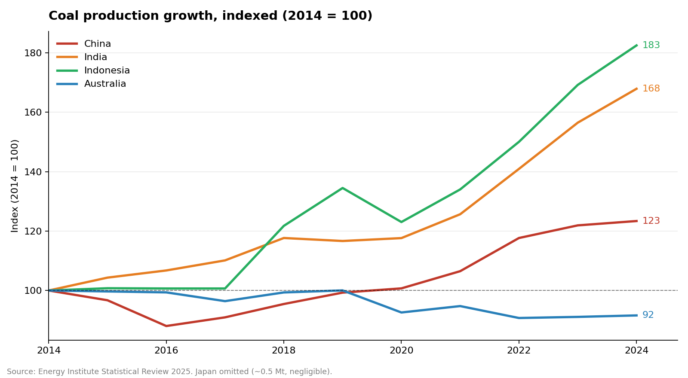
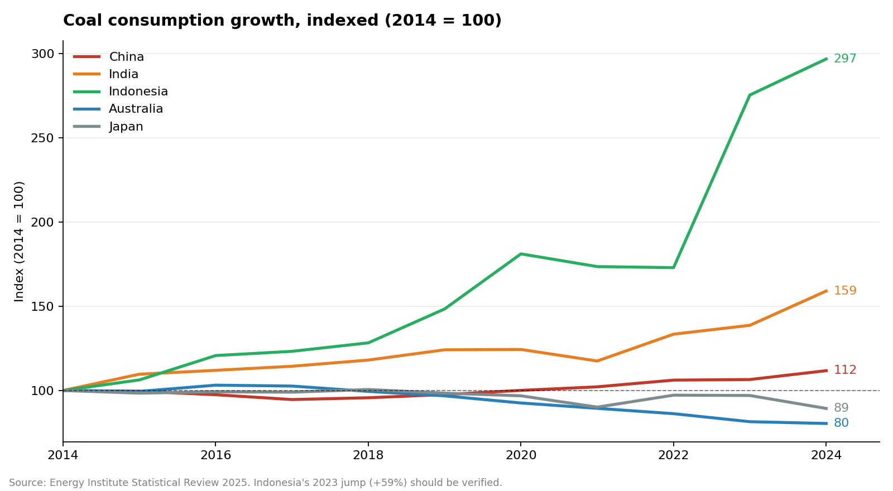
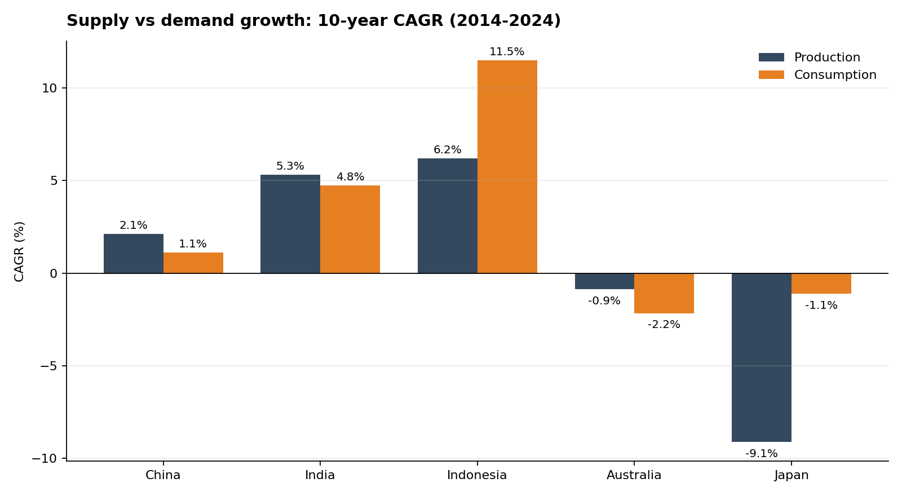
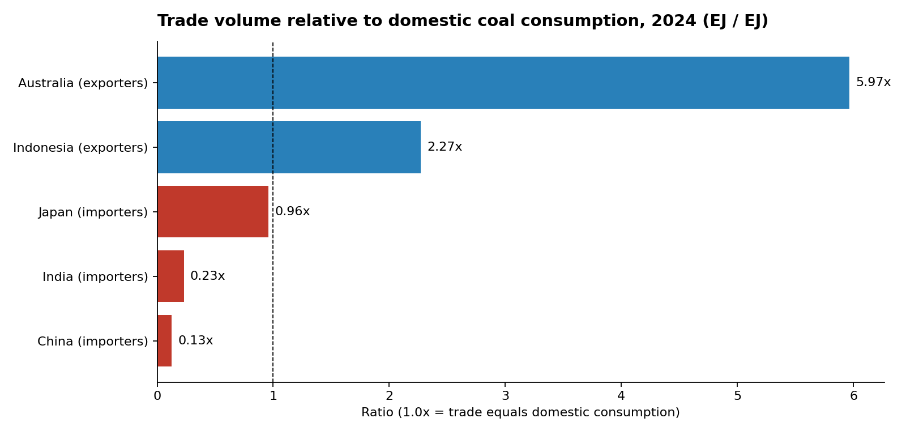
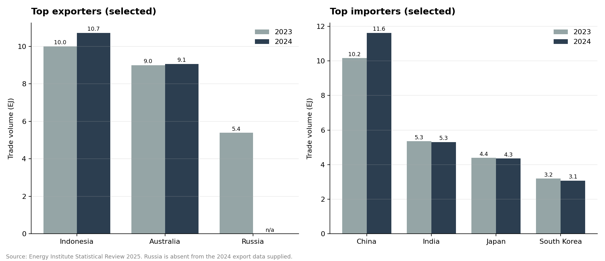
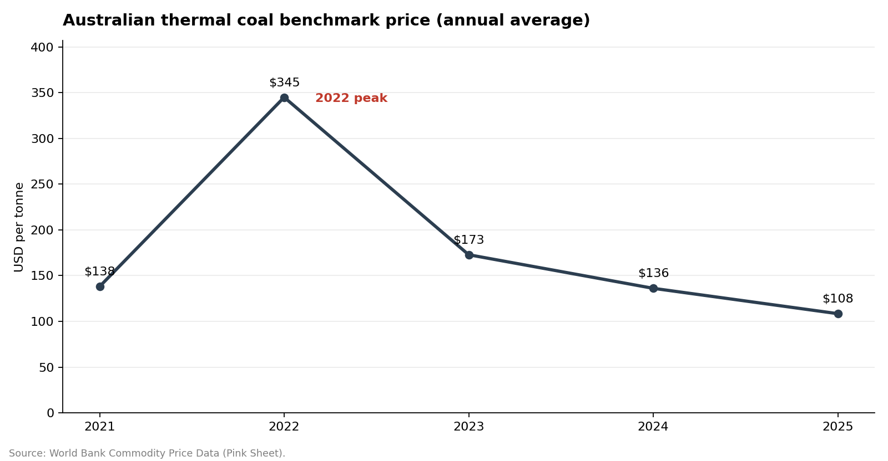

# Coal Market & Supply Analytics

An end-to-end business-analyst project: public energy and commodity data → validation → market analysis → SQL → a formula-driven Excel workbook with a dashboard.

**Scope:** China, India, Indonesia, Australia and Japan (production and consumption, 2014-2024), selected coal exporters/importers (2023-2024) and the Australian thermal coal benchmark price (2021-2025).

## Business questions

1. Which markets show sustained supply and demand growth, and where do the two diverge?
2. Which countries depend on exports or imports relative to their own coal use?
3. How concentrated is selected international coal trade?
4. How has the benchmark thermal-coal price moved since the 2022 spike?
5. Which data points must be verified before anyone relies on the conclusions?

## Key findings

*Historical observations only. Not forecasts or investment advice. Numbers come from `outputs/key_findings.md`, which the pipeline generates.*

- **China dominates scale.** 4,780 Mt produced in 2024 (67% of the five markets) and 92.2 EJ consumed (73%).
- **India is the growth story.** Production grew 5.3% a year and consumption 4.8% a year over 2014-2024. In 2024, India's consumption rose 14.7% (+2.9 EJ) while its imports were flat (5.35 to 5.30 EJ), so the increase was met by domestic supply, with production up 7.3%.
- **Indonesia and Australia are export economies.** Indonesia exported 10.72 EJ in 2024, 2.3x its domestic consumption. Australia exported 9.07 EJ, 6.0x its domestic consumption, while its own production and consumption both shrank (indices 92 and 80 versus 2014).
- **Japan is almost fully import-reliant.** 2024 imports were 96% of its domestic consumption, and domestic production is about 0.5 Mt.
- **China's import pull increased.** Imports rose 14.4% to 11.62 EJ and its share of world trade went from 28.7% to 32.3%.
- **Trade is concentrated.** Indonesia and Australia together supplied 55.0% of world coal trade in 2024 (53.6% in 2023, like-for-like). The four listed importers took 67.6% (65.2% in 2023).
- **Price normalised after the spike.** Australian thermal coal peaked at $345/t in 2022 and was $108/t in 2025, 69% below the peak and 22% below 2021. It fell in 2023, 2024 and 2025 even though China's and India's consumption grew every year and India's and Indonesia's production expanded. Three data points cannot prove why, so this is a question for further research, not a conclusion.

| | |
|---|---|
|  |  |
|  |  |
|  |  |

## Data quality: what the validation found

`python/market_analysis.py` runs 24 checks and writes `data/processed/data_quality_report.csv` (19 pass, 4 warnings, 1 info). The warnings are carried into the Excel workbook so nobody reads a number without its caveat.

| Warning | Why it matters |
|---|---|
| Indonesia consumption +59.3% in 2023 | Drives Indonesia's 11.5% consumption CAGR. Verify against the Energy Institute workbook before quoting it. |
| Russia is an exporter in 2023 but missing in 2024 | Listed-country totals are not comparable across years, so YoY and concentration use only countries present in both. |
| Price history is 2021-2025, market data is 2014-2024 | Price conclusions cover a short window. |
| Japan production about 0.5 Mt | Percentage changes on a tiny base are not meaningful. |

## Method notes

- **Units.** Production is in million tonnes (Mt). Consumption and trade are in exajoules (EJ). They are never subtracted. Supply and demand are compared through growth rates (CAGR) and indices (2014 = 100). Trade is compared with consumption because both are in EJ (trade / domestic consumption).
- **CAGR** = (end / start)^(1 / years) - 1, over the full 10 years and the recent 5 (2019-2024).
- **Concentration.** The HHI uses only the countries listed, so it is a **lower bound**. Combined share on the like-for-like set is the safer comparison.
- **Implied world trade** = trade volume / share. It is 35.4 EJ (2023) and 36.0 EJ (2024) with under 1% spread across rows, which is an internal consistency check on the trade file.

## Repository structure

```
coal-market-analytics/
├── README.md
├── requirements.txt
├── data/
│   ├── raw/          5 source CSV files + SOURCE_NOTES.txt (original values, unchanged)
│   └── processed/    country_market_metrics, country_summary, trade_metrics, trade_concentration,
│                     price_metrics, price_detail_clean, data_quality_report
├── python/
│   ├── market_analysis.py     validate -> metrics -> charts -> findings
│   ├── build_excel.py         builds the formula-driven workbook
│   └── run_sql_checks.py      runs every SQL query in SQLite and saves the results
├── sql/
│   ├── 01_schema.sql          tables with primary keys + view (MySQL 8)
│   ├── 02_load_data.sql       LOAD DATA LOCAL INFILE from data/raw
│   └── 03_business_queries.sql  14 queries (rankings, CAGR, LAG, concentration, price, data-quality checks)
├── excel/coal_market_business_analysis.xlsx
├── outputs/          6 charts, key_findings.md, sql_query_results.md
└── docs/AUDIT_AND_FIXES.md
```

## How to run

```bash
pip install -r requirements.txt

python python/market_analysis.py   # validation report, processed CSVs, charts, findings
python python/build_excel.py       # rebuilds the Excel workbook
python python/run_sql_checks.py    # runs all SQL queries in SQLite (no server needed)
```

**MySQL 8:**

```bash
mysql --local-infile=1 -u <user> -p < sql/01_schema.sql
mysql --local-infile=1 -u <user> -p < sql/02_load_data.sql   # run from the project root
mysql -u <user> -p < sql/03_business_queries.sql
```

The queries use ANSI features (CTEs, window functions, CASE, POWER) and were verified end to end in SQLite 3.45. The `LOAD DATA` script is standard MySQL syntax but has not been run against a live MySQL server.

## Excel workbook

Open `excel/coal_market_business_analysis.xlsx`. Every analytical number is a live formula, so editing the `Data_*` sheets recalculates everything.

| Sheet | Contents |
|---|---|
| Executive Summary | 19 live KPIs, key findings, which sheet answers which question |
| Business Dashboard | KPI tiles and 4 charts (production index, consumption index, trade, price) |
| Market Trends | CAGR, shares, ranks, growth gap and a signal per country, with index tables |
| Trade Analysis | YoY, share change, trade / consumption, concentration, coverage flags |
| Price Analysis | YoY, index, distance from peak, annual vs quarterly reconciliation |
| Data_Market, Data_Trade, Data_Prices | Source data (blue font), two as Excel Tables |
| Data Quality, Notes | Validation results, units, conventions |

Functions used: SUMIFS, COUNTIFS, AVERAGEIFS, INDEX/MATCH, SUMPRODUCT, RANK, IF/IFERROR, plus conditional formatting (colour scales, data bars, flags). Lookups use INDEX/MATCH rather than XLOOKUP so the file also calculates in older Excel and LibreOffice.

**PivotTable:** a script cannot create a native PivotTable. `Data_Market` is an Excel Table, so click inside it and choose Insert > PivotTable (about a minute).

## Extending the price history

1. Download the World Bank Pink Sheet (monthly or annual) from the link in `data/raw/SOURCE_NOTES.txt`.
2. Add the earlier years (for example 2014-2020) to `data/raw/coal_price_worldbank_2021_2025.csv` using the same two headers.
3. Rerun the three commands above. The Python metrics and SQL adapt to any number of years. For Excel, the Price Analysis table shows five years, so extend its rows or build a longer table from `Data_Prices`.

## Limitations

- Selected countries only. Trade shares use the source's world total, but the list of exporters and importers is not complete.
- Historical statistics are revised by their publishers. The values in `data/raw/` were not re-checked against the source files when this version was built.
- The analysis describes history. It does not forecast demand or prices.
- Commercial conclusions would need company-level data, logistics, contract terms and regulation.

## Tools

Python (pandas, NumPy, Matplotlib, openpyxl), SQL (MySQL 8 / SQLite), Microsoft Excel.
